# Проект "Информационная служба оптовой фирмы"

Данный проект является результатом командной работы трёх человек.  

Проект написан на платформе `.NET` с использованием технологи `Windows Forms` и `ADO.NET` на языке программирования `C#`.  
В качестве СУБД был выбран `MySQL`. Все запросы по обращению к базе данных прописаны на чистом `SQL`.
## Легенда проекта
Оптовая фирма торгует продуктами питания.  
Ассортимент товаров включает как фасованные продукты, так и весовые.  
Фирма состоит из четырех подразделений:  
* Склад  
* Отдел продаж
* Бухгалтерия
* Отдел маркетинга  

Подразделения разнесены территориально.

### Задача
Необходимо создать распределённую программную системы, обеспечивающую совместную работу всех четырёх подразделений.   
У каждого подразделения есть свои функции в системе: 
#### Склад
|№|Функция															  |
|-|-------------------------------------------------------------------|
|1|Регистрация товара, поступающего на склад.                         |
|2|Поиск товара с истекшим сроком хранения. Составление акта списания.|
|3|Выдача товара (по накладной или по акту списания)                  |

#### Бухгалтерия
|№|Функция                          |
|-|---------------------------------|
|1|Назначение продажной цены товара.|
|2|Расчет прибыли за период.        |

#### Отдел продаж
|№|Функция|
|-|------------------|
|1|Оформление заказа.|

#### Отдел маркетинга
|№|Функция                                               |
|-|------------------------------------------------------|
|1|Определение 10-ти наиболее часто заказываемых товаров.|
|2|Определение 10-ти наименее часто заказываемых товаров.|
|3|Определение 10-ти наименее прибыльных товаров.        |
|4|Определение 10-ти наиболее прибыльных товаров.        |

## Результат работы

Структура проекта получилась следующей:  
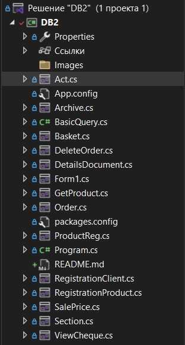 

Для каждой функции определённого подразделения создают дочерние формы, в которых прописана вся логика функции.  

Данный подход улучшил читаемость кода проекта и его масштабируемость.

Результаты работы по каждому подразделению и его функциям:
* **Склад**  
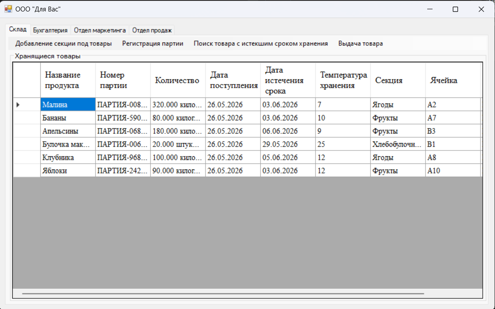  
*Функции склада*:  
	* Добавление секции под товар  
	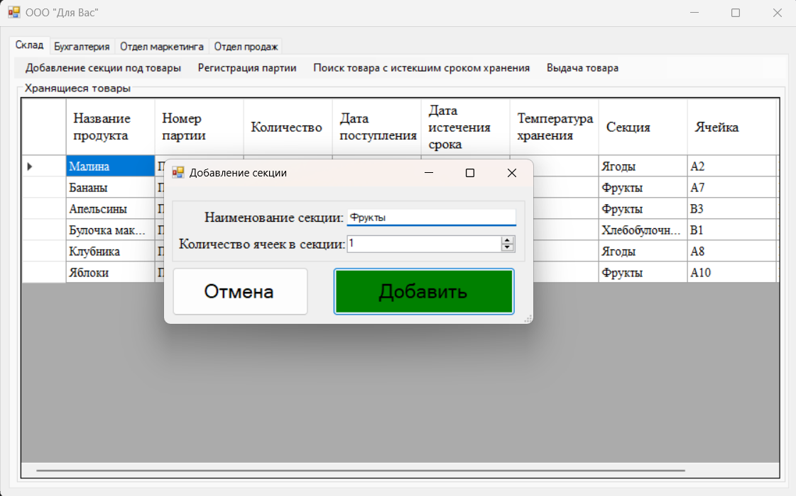
	* Регистрация партии  
	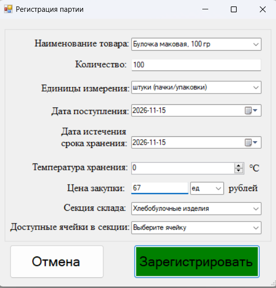
	* Поиск товара с истекшим сроком хранения  
	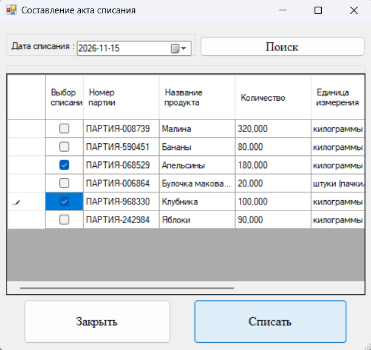
	* Выдача товара  
	
* **Бухгалтерия**  
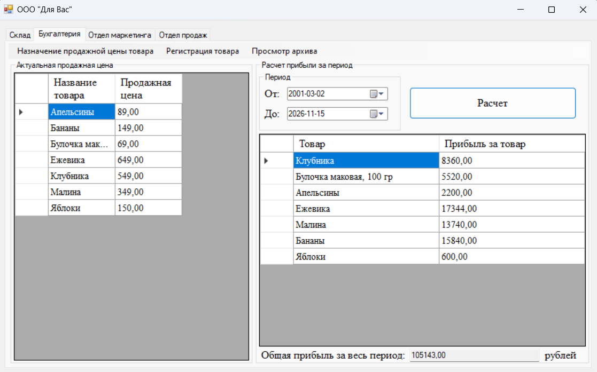  
*Функции бухгалтерии*:  
	* Назначение продажной цены  
	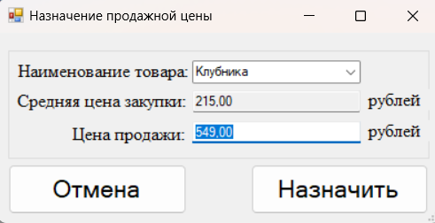
	* Регистрация товара  
	
	* Просмотр архива  
	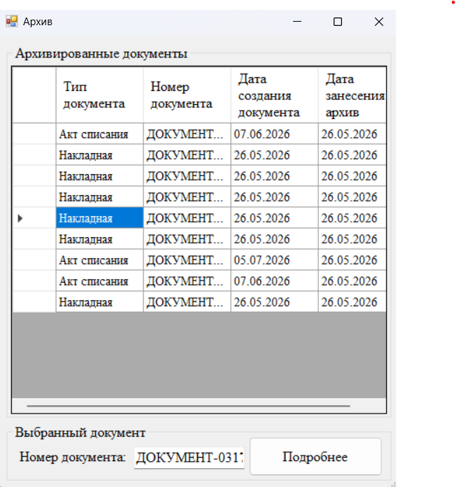
* **Отдел маркетинга**  
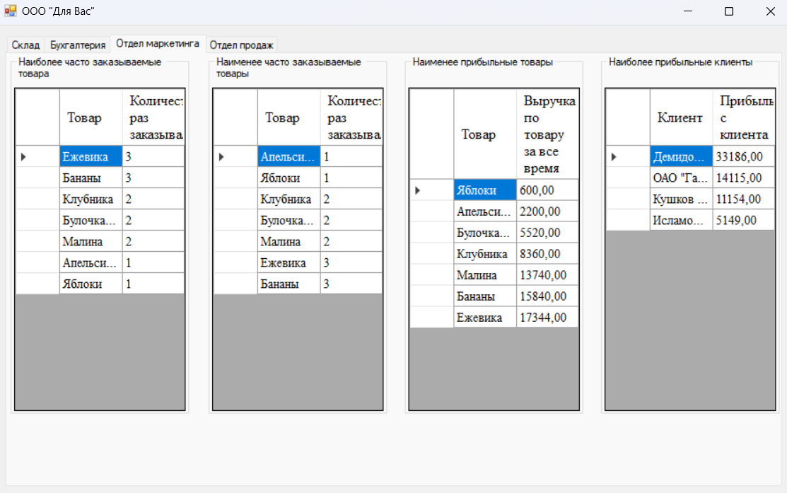
* **Отдел продаж**
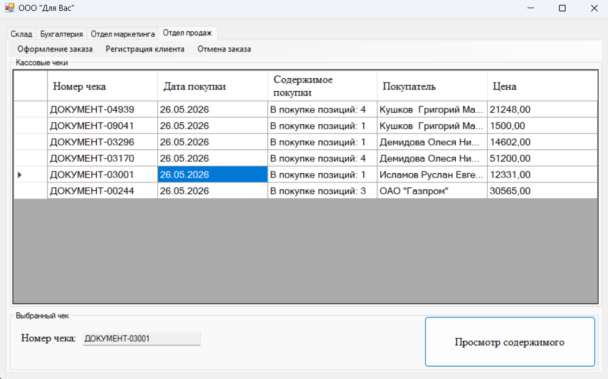
*Функции отдела продаж*:  
	* Оформление заказа  
	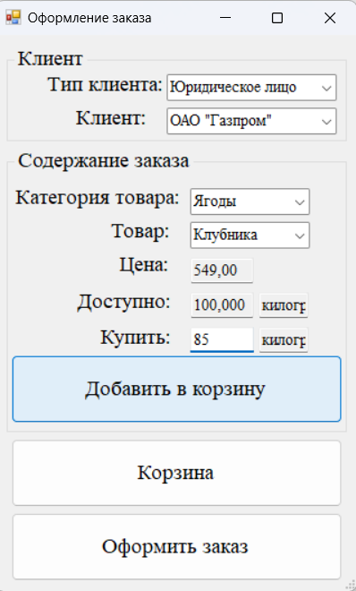
	* Регистрация клиента  
	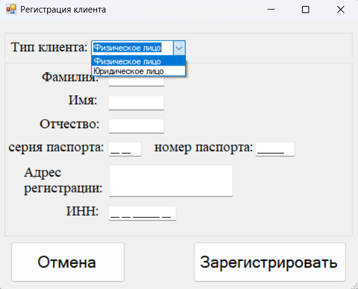
	* Отмена заказа  
	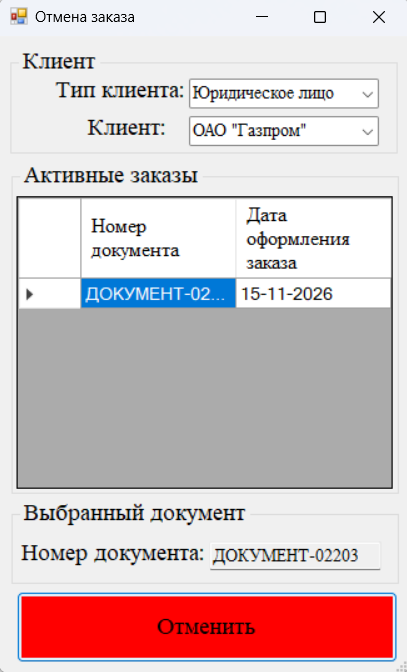

